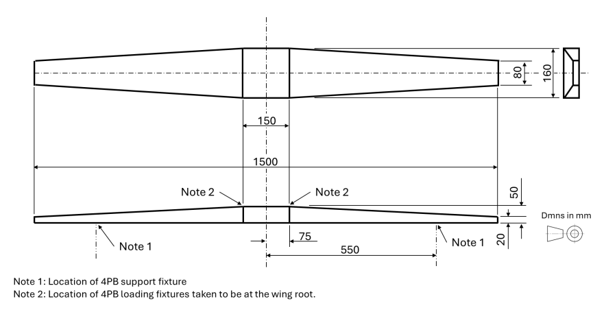

# - Wing Box Creation -
<h2> Description </h2>
As a team project for my course, I was tasked to design and build a wing box from card and metal rivets. It was then to be subject to bending loads and expected to withstand a load limit of 90N. Bellow I have included the detailed specifications, photos of the wing box then a report of the project. 

This was a group project with teams of 15 people. Each team then split into sub groups who would focus on each individual part of the wing to increase efficiency and allow us to get the wing built in the short time we had. 
My personal role within the group was Materials Coordinator, this role put me in charge of communicating with each group to find out the amount of materials that we would have to order to complete the wing. 

<h2>Specific Requirements</h2>

<h4>Functional requirements</h4>

- ADBT-R-1 The structure shall demonstrate design and manufacture techniques for an idealised
semi-monocoque (stiffened skin) aerospace wing box.

- ADBT-R-2 The structure shall be subject to a single load case generating wing bending through
the application of a single vertical load in the configuration shown in Figure 1.

<h4>Performance requirements</h4>

- ADBT-R-3 The design limit load for the loading specified in ADBT-R-2 shall be a 90 N.

<h4>Interface requirements</h4>

- ADBT-R-4 Ribs shall be located at the loading and support points indicated in Figure 1.

<h4>Physical requirements</h4>

- ADBT-R-5 The shape and dimensions of the structure shall conform to Figure 1.

- ADBT-R-6 Internal component distribution and gauge selection shall ensure the structure is
symmetrical about the chordwise and spanwise centrelines of the wing indicated on
Figure 1.

<h4>Design requirements</h4>
- ADBT-R-7 The design shall include an Ultimate Factor of Safety of 1.5.

- ADBT-R-8 Reserve Factors (RFs) for all considered failure modes shall be greater than or equal
to 1.0.

- ADBT-R-9 Stress analysis shall be conducted using the appropriate approved design
methodology provided in document ADBT-D-2.

- ADBT-R-10 The primary material type and gauge shall be selected from an approved list in
document ADBT-D-2 that simulate thin sheet stock materials.

- ADBT-R-11 Rivets from an approved size range given in document ADBT-D-2 shall be used to join
sheet components.

- ADBT-R-12 Spars shall be formed by bending of approved sheet material to C section form.

- ADBT-R-13 Stringers shall be formed by bending approved sheet material to L section form.

- ADBT-R-14 The flange width for stringers, spars and rib feet shall be 10 mm.

- ADBT-R-15 On spanwise rivet runs the maximum spacing between rivets shall be 50 mm.

<h4>Environmental requirements</h4>

- ADBT-R-16 The structure shall be constructed and tested in a typical indoor laboratory and
workshop environment.

 

  
   
  <em> Figure 1 </em>

<h2> Construction </h2>

Each group was in charge of making a diffrent aspect of the wing. The groups were:

- Upper Skins and Stringers

- Lower Skins and Stringers

- Ribs

- Spars

I was in charge of making the upper skin and the stringers, our group managed to design and construct our part with little effort which allowed us to join and help the other groups. Team communication was also essential as each individuals measurements had to match so the whole wing would fit together. 

We drew the schematics onto the card then cut out the desired shapes. After that we riveted the skin and stringers together, then assembled the whole wing once each team had completed their respective roles. 
